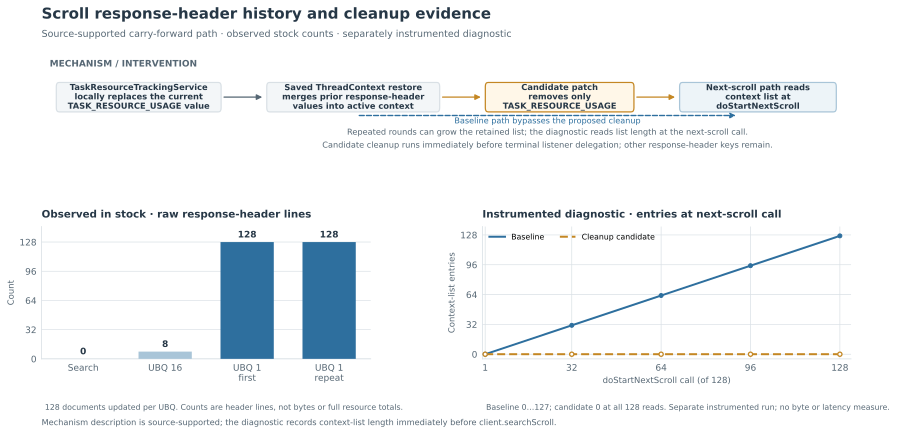
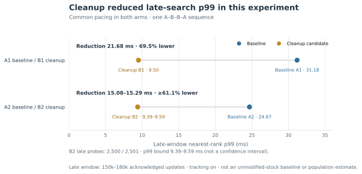

# `TASK_RESOURCE_USAGE` response headers in update-by-query scrolls

During a long-running update-by-query (UBQ), searches running on the same OpenSearch cluster can get progressively slower. This repository investigates one possible contributor on OpenSearch 2.19: task-resource response headers carried forward across internal scroll requests.

**What can be reproduced on stock OpenSearch:** a 128-document UBQ returned **8 `TASK_RESOURCE_USAGE` header lines** with scroll size 16, but **128 lines** with scroll size 1. These headers contain task IDs and CPU/memory-usage values ([producer source](https://github.com/opensearch-project/OpenSearch/blob/fd9a9d90df25bea1af2c6a85039692e815b894f5/server/src/main/java/org/opensearch/tasks/TaskResourceTrackingService.java#L283-L325)). They are not document counts or total resource accounting. A separate instrumented diagnostic observed earlier values surviving into later scroll continuations.

**Why latency matters:** in a separate, controlled experiment with task tracking enabled and matched update throughput, a proposed scroll-header cleanup reduced *late-stage concurrent-search p99* by **69.5% and at least 61.1%** in two order pairs. This does **not** mean that the tiny stock reproduction measures latency, or that the result is a production-wide improvement. The [figures](#proposed-cleanup-and-performance-evidence), [source-level explanation](#why-scroll-continuations-can-carry-earlier-entries), and [saved results](results/) separate those claims.

## Reproduce

Requirements: Linux x86-64 (the tested host architecture), Python 3.10+, Bash, curl, Docker CLI, and permission to use the default local Docker daemon through its Unix socket. Use native amd64 for this reproduction. The otherwise idle daemon must have no containers, including stopped containers; Docker context and endpoint overrides must be unset. The fixture uses 2 CPUs and a 2 GiB memory-and-swap container limit, so the host needs additional memory headroom. It also uses a 512 MiB JVM heap and a 256 MiB data tmpfs. The retained stock run used the pinned Linux/amd64 image ([container log](results/stock/container.log)); its unpacked Docker image size was 1,443,902,696 bytes ([stock run report](results/stock/REPORT.md)). Allow disk headroom for the roughly 1.45 GB image and Docker runtime files. The wrapper pulls the pinned image if needed and runs the byte-identical [`reproduce.py`](reproduce.py).

```sh
./run-reproduction.sh
```

The wrapper writes a new `results/run-<unique-id>` directory and verifies that run. The folder UUID labels the evidence directory; the reproducer generates a separate owner UUID in its receipt and uses it to identify and clean up its one container. To verify the included stock run offline, without Docker or HTTP:

```sh
python3 reproduce.py --verify results/stock
```

The live run and offline verification share the same validator; this is not independent verification or a signed attestation. The runner restricts Docker work to its owned container and requires clean initial/final container checks; see [`reproduce.py`](reproduce.py) and [`run-reproduction.sh`](run-reproduction.sh).

To start from a fresh checkout:

```sh
git clone https://github.com/camerondurham/repro-opensearch-2-task-header-latency.git
cd repro-opensearch-2-task-header-latency
./run-reproduction.sh
```

## Stock result

| Request | Header lines | Updated documents | Batches | Revision sum after request |
|---|---:|---:|---:|---:|
| Ordinary search | 0 | — | — | 0 (initial) |
| Update-by-query, scroll 16 | 8 | 128 | 8 | 128 |
| Update-by-query, scroll 1 | 128 | 128 | 128 | 256 |
| Same update-by-query, scroll 1 | 128 | 128 | 128 | 384 |

Each update-by-query completed 128 updates without reported failures. These are literal response-header occurrences at request completion. They do not measure header bytes, latency, task resource totals, or growth across distinct update-by-query requests. The raw evidence and its projection notes are in [`results/stock/REPORT.md`](results/stock/REPORT.md) and [`results/stock/evidence-manifest.json`](results/stock/evidence-manifest.json).

## Why scroll continuations can carry earlier entries

The producer updates the current response-header key in [`TaskResourceTrackingService`](https://github.com/opensearch-project/OpenSearch/blob/fd9a9d90df25bea1af2c6a85039692e815b894f5/server/src/main/java/org/opensearch/tasks/TaskResourceTrackingService.java#L283-L325); it does not blindly append every measurement. A saved [`ThreadContext`](https://github.com/opensearch-project/OpenSearch/blob/fd9a9d90df25bea1af2c6a85039692e815b894f5/server/src/main/java/org/opensearch/common/util/concurrent/ThreadContext.java#L322-L365) preserves response headers, and restoration merges saved and incoming values, retaining distinct strings ([merge implementation](https://github.com/opensearch-project/OpenSearch/blob/fd9a9d90df25bea1af2c6a85039692e815b894f5/server/src/main/java/org/opensearch/common/util/concurrent/ThreadContext.java#L790-L808)). In the inspected source, transport captures a restorable response context ([`TransportService`](https://github.com/opensearch-project/OpenSearch/blob/fd9a9d90df25bea1af2c6a85039692e815b894f5/server/src/main/java/org/opensearch/transport/TransportService.java#L978-L979)); update-by-query requests further scrolls after each asynchronous response ([`ScrollableHitSource`](https://github.com/opensearch-project/OpenSearch/blob/fd9a9d90df25bea1af2c6a85039692e815b894f5/server/src/main/java/org/opensearch/index/reindex/ScrollableHitSource.java#L120-L135)). Ordinary search has request-end/failure cleanup through [`SearchTaskRequestOperationsListener`](https://github.com/opensearch-project/OpenSearch/blob/fd9a9d90df25bea1af2c6a85039692e815b894f5/server/src/main/java/org/opensearch/action/search/SearchTaskRequestOperationsListener.java#L27-L37); the inspected [`SearchScrollAsyncAction`](https://github.com/opensearch-project/OpenSearch/blob/fd9a9d90df25bea1af2c6a85039692e815b894f5/server/src/main/java/org/opensearch/action/search/SearchScrollAsyncAction.java#L288-L309) has no equivalent cleanup.

A separate instrumented diagnostic sampled the response context at `doStartNextScroll`, immediately before `client.searchScroll`. Across 128 successive next-scroll observations, the baseline held 0 through 127 distinct values; the cleanup candidate held zero. The increasing counts are consistent with earlier distinct entries being carried forward, as the source mechanism predicts. This supports the explanation in the tested path; the hook does not directly inspect every continuation capture or transport hop. The figure combines this diagnostic with the stock counts and source-supported lifecycle path:



Carrying more distinct header values can increase context copying, serialization, allocation, and transport work, which may affect concurrent latency. No profiler or isolated wire-byte attribution measured that mediation.

## Proposed cleanup and performance evidence

[`proposed-fix.patch`](proposed-fix.patch) removes only `TASK_RESOURCE_USAGE` before terminal listener delegation. This lets downstream code run after cleanup and capture the next continuation without the observed history. It does not change the producer, generic `ThreadContext`, worker pacing, or other response headers. It remains a proposal; external consumers, successful distributed phases, and cancellation paths that bypass the terminal callback need maintainer review.

The stock reproduction, the instrumented diagnostic, and the performance campaign are separate evidence. The campaign compared stock scroll transport with the cleanup candidate while both used the same experimental worker-pacing control. It was one common-paced A1/B1/B2/A2 ABBA sequence, not a stock latency baseline or independent replication.



Late-progress p99 fell 69.5% in A1/B1 and at least 61.1% in A2/B2. Recompute the saved late-window values offline with `python3 results/performance/recompute_late_p99.py`; see [`results/performance/`](results/performance/) for data and method. The public performance projection contains **late-window samples only**, not the complete UBQ timeline; it cannot produce an honest full-duration latency ramp without additional reviewed measurements. [Figure follow-up](https://github.com/camerondurham/repro-opensearch-2-task-header-latency/issues/1). This is conditional intervention evidence from one campaign, not a population estimate, confidence interval, proof that cleanup is the dominant cause, or a production-wide speedup. The historical unpaced experiment remains inconclusive. Equal updated-document totals establish document work, not resource-accounting invariance or universal plugin/cancellation safety.

## Source pin, license, and support

Source inspection uses OpenSearch commit [`fd9a9d90df25bea1af2c6a85039692e815b894f5`](https://github.com/opensearch-project/OpenSearch/tree/fd9a9d90df25bea1af2c6a85039692e815b894f5), including ordinary-search changes [#16532](https://github.com/opensearch-project/OpenSearch/pull/16532) and [#16536](https://github.com/opensearch-project/OpenSearch/pull/16536). See [`SUPPORT.md`](SUPPORT.md) for maintainer questions about the header contract and target branch. This extraction is provided under [Apache License 2.0](LICENSE.txt); see [`NOTICE.txt`](NOTICE.txt).
