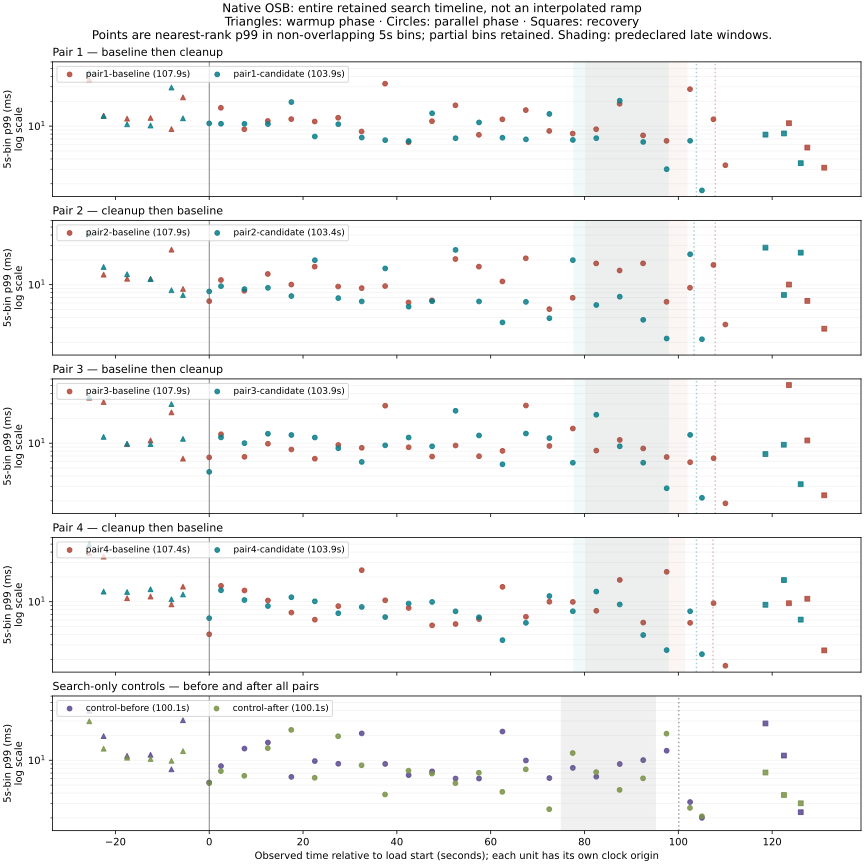

# Current OSB procedure: lifecycle reproduced, performance criterion not met

**Do not present the earlier positive TCP result as conclusive proof for this
procedure.** The second, process-private queue-actor campaign passed all execution
and measurement gates but its four-pair 95% interval includes no improvement.
The mean effect is favorable; the predeclared uncertainty requirement failed.
This is insufficient performance evidence, not proof of no performance cost.

## Why there is a second campaign

Review found that native TCP actor bootstrap can adopt a foreign administrator
appearing after OSB's initial check and then shut it down. A port probe cannot
make that safe. The final driver selects OSB's existing native
`multiprocQueueBase` through `use_offline_actor_system()`, with a version-checked
adapter that bypasses only shared TCP discovery and fails closed if the selected
base changes. Installed OSB source, HTTP requests, scheduler and metric timing
are otherwise unchanged. Remote workers are intentionally unsupported; the three
OpenSearch nodes still run as separate bounded containers on this host.

The [protocol amendment](isolated-campaign/PROTOCOL.md) was committed **before**
this new campaign, at runtime snapshot
`44b9bd9d86e5ef1d01e732b59cc946ece6af506c`
([source manifest](isolated-campaign/source-manifest.json)). It requires the same
four AB/BA/AB/BA pairs, two controls, ≥20% and ≥2 ms late-progress p99 service-time
endpoint, interval excluding no improvement, and the same validation gates.
The original [TCP campaign](campaign/report.json) remains unchanged. The two
campaigns are **not pooled**, and neither is selected for a favorable conclusion.
Changing transport and running later are confounded, so the different intervals
cannot be attributed specifically to queue versus TCP messaging.

## Results in actual run order

All engine source/image/build/patch/dependency identities match the earlier
campaign: OpenSearch 2.19.0, OSB 2.5.0, Thespian 3.10.6, CPython 3.11.16,
OpenSearch-py 2.8.0, aiohttp 3.14.5. The deterministic 12,000-document corpus hash
is `59f436620a8a3f2c1bf40e92b7a80f991cc5839e58b802c76442af30a32a73ba`.
See [build](isolated-campaign/build.json), [software](isolated-campaign/software.json),
[frozen code](isolated-campaign/code/), and each unit's receipt/workload/raw metrics.

| Unit | Load seconds | UBQ docs/s | Search req/s | Late samples | Late service p99 ms | Late latency p99 ms | Full load service p99 ms |
|---|---:|---:|---:|---:|---:|---:|---:|
| control-before | 100.10 | — | 49.991 | 1000 | 9.006 | 10.348 | 9.581 |
| pair1-baseline | 107.88 | 111.23 | 49.999 | 1078 | 18.035 | 18.506 | 11.978 |
| pair1-candidate | 103.85 | 115.55 | 49.993 | 1002 | 10.839 | 11.550 | 10.631 |
| pair2-candidate | 103.36 | 116.10 | 50.001 | 1002 | 6.932 | 7.648 | 7.684 |
| pair2-baseline | 107.88 | 111.24 | 49.992 | 1079 | 14.850 | 15.768 | 12.388 |
| pair3-baseline | 107.87 | 111.24 | 49.993 | 1078 | 8.640 | 9.230 | 9.524 |
| pair3-candidate | 103.88 | 115.52 | 50.002 | 1004 | 8.328 | 8.791 | 9.837 |
| pair4-candidate | 103.87 | 115.53 | 49.988 | 1002 | 8.202 | 8.482 | 9.450 |
| pair4-baseline | 107.39 | 111.74 | 49.986 | 1053 | 11.628 | 12.092 | 9.751 |
| control-after | 100.08 | — | 50.008 | 1000 | 7.183 | 7.998 | 7.480 |

Paired reductions: **39.900%, 53.316%, 3.610%, 29.465%**; absolute differences
**7.196, 7.917, 0.312, 3.426 ms**. Geometric-mean candidate/baseline ratio
**0.660876** (33.9% reduction), 95% t interval over four paired log ratios
**[0.407675, 1.071336]**; mean absolute difference **4.713 ms**.
The interval crosses 1, so `practically_meaningful_effect_supported=false`.
No per-request sample independence, additional repetitions, altered endpoint,
selective pair removal or pooled interval is used to turn that result positive.

The ten load windows contain **52,303 search observations**, **10,298 late
observations**, **10 boundary exclusions**. All eight UBQs completed exactly
12,000 updates each (96,000 total), controls retained revision sum zero, and all
search hit totals matched. Operation errors, executor/server timeouts, UBQ
failures/retries/version conflicts, missing metric counterparts and known native
drop warnings were zero. Achieved search load remained approximately 50/s.
Candidate UBQ rates were 3.4–4.4% higher under the same throttle, inside the
predeclared 10% tolerance—not identical pacing. All resource/host gates passed;
all owned Docker resources and live tagged actor processes were cleaned.
Whole-triplet metric loss still cannot be categorically ruled out.

## Full duration and qualification



As in the earlier campaign, all warmup, concurrent and recovery search observations
contribute to phase-separated non-overlapping 5s bins. These descriptive p99s are
not replicates and are not the primary late-window statistic. The figure retains
partial bins and gaps without interpolation. No monotonic ramp is established.

The [queue smoke](isolated-smoke/report.json) reproduces untouched stock and
baseline 0/8/128/128 versus cleanup 0/0/0/0 headers, default-client rejection versus
acceptance, preserved unrelated headers, and 128 documents/revision sum 512 in
every arm. The [queue boundary smoke](isolated-boundary-smoke/report.json) also
passed its 40s control and >35s 4,800-update UBQs. These are qualifications, not
extra performance replicates.

Native actor tests include the false→foreign bootstrap race control, version/base
failure guards, two simultaneous actual private queue actor systems with the same
global actor name, shutdown of one leaving the other usable, zero connections to
a loopback-only TCP sentinel, and exact-owner detached-process cleanup. No global
TCP actor system is created or killed by those tests. All remaining safety limits
(callback coverage only; no plugin/resource-accounting invariance/full upstream
suite) remain as described in [the earlier detailed report](REPORT.md).

## What this proves and does not prove

- **Observed:** stock repeated task-resource headers exceed a real pinned client's
  default parser cap; proposed cleanup removes them with exact document accounting.
- **Source-supported inference:** the ordinary-search/scroll lifecycle asymmetry
  and response-context merging explain the retained history; maintainers must
  still confirm the external header contract.
- **Performance:** two separately retained same-host campaigns show favorable
  point estimates; only the earlier TCP campaign passed the uncertainty criterion.
  The **current canonical queue procedure does not conclusively establish the
  predeclared practical performance effect**. Four pairs, host/order/JIT/cache/GC
  effects, different achieved UBQ rates and no isolated profiler limit attribution.
- **Scope:** synthetic 2.19.0 on one NixOS/WSL2 machine, not every release, workload,
  machine or production deployment. Not issue #23162. No claim that header count
  alone proves a latency bug. Do not combine these with historical 69.5%/≥61.1%
  common-paced results as independent replications.

```sh
python3 osb/verify.py
python3 osb/analyze.py results/osb/isolated-campaign
python3 osb/isolated_plot.py --verify
./osb/run.sh test
# Optional figure regeneration, using the hash-locked plotting environment:
.local/osb/plot-venv/bin/python osb/isolated_plot.py
```

AI assistance remains GPT-6 Astra/xhigh via the authorized Pi
`openai/gpt-6-astra` route. All builds and real measurements ran on the same NixOS
machine. Public evidence is synthetic and allowlisted; private logs remain local.
