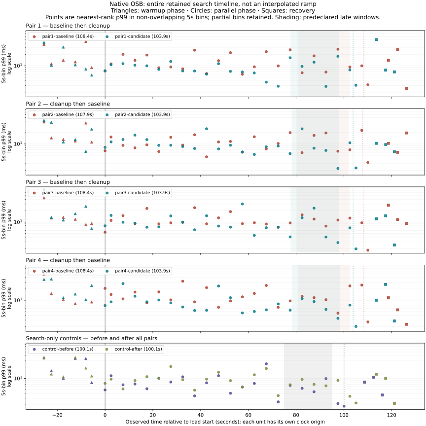

# Native OSB evidence: three distinct conclusions

## Verdict

1. **Observed lifecycle/client symptom:** untouched stock OpenSearch 2.19.0 and
   the matched recompiled baseline returned 0/8/128/128 task-resource header lines;
   the cleanup returned 0/0/0/0. The stock/baseline responses also caused the pinned
   aiohttp 3.14.5 default parser to reject the response as “Too many headers
   received”. Cleanup was accepted. Correct final totals: 128 documents, revision
   sum 512 for every smoke. The diagnostic parser status 400 is not a server 400.
2. **Induced performance cost supported in this experiment:** four fresh-cluster
   three-node pairs passed the predeclared ≥20% and ≥2 ms late-progress p99
   service-time endpoint. Geometric-mean candidate/baseline ratio **0.558743**
   (44.1% reduction); 95% Student-t interval over four paired log ratios
   **[0.364583, 0.856303]**; mean difference **6.407 ms**. All gates passed.
3. **Fix safety is only bounded:** exact document/update accounting, callback
   success/failure/cancellation, continuation context, unrelated state/headers,
   and live malformed/expired scroll checks passed. External consumers, all
   distributed paths, plugin compatibility, and cancellation bypassing that
   callback remain unproven. This does not establish resource-accounting invariance.

This supports reporting a reproducible lifecycle/compatibility defect and a
conditional performance effect—not universal proof that this header is unnecessary
or a production-wide speedup. The intended external header contract still needs
maintainer confirmation. This is **not OpenSearch issue #23162**, which concerns
keyword sorting/max clauses.

## What ran and what changed

The target was the latest reproduction repository main at start and recheck:
`70ea0f04244a49e837d74c8a54f92439587b93da`. The engine is deliberately pinned to
**2.19.0**, not claimed to be the latest OpenSearch 2 release.

| Input | Exact identity |
|---|---|
| OpenSearch source | `fd9a9d90df25bea1af2c6a85039692e815b894f5` |
| Stock image manifest | `sha256:1f8b88245a6af61e7aa500afe0e87d43401e4b33140bb47230a919428ce3f7cb` |
| Stock runtime image | `sha256:6db639f27ec51b557b5abe39ccba65b3fae848d8cc4bd12dde724b8074e7ac91` |
| Baseline runtime image | `sha256:f3dc5baf9a2ce278f9c1c19769c5923c507d070df7e2f01f8d71c85efdb8da45` |
| Cleanup runtime image | `sha256:f467123acb766105a0df9c70464405c98716e8554b7013e223ac02a308c699be` |
| OSB | 2.5.0; source tag commit `445eb5a3188c1e3d3a3ca6bfe87757902ce5b10e` |
| Python / client | CPython 3.11.16 / opensearch-py 2.8.0 / aiohttp 3.14.5 |
| Compiler | stock Temurin 21.0.6+7, `javac --release 11 -proc:none` |
| Runtime snapshot start | `cf95f7dc1fc9ab8a3b50d9bae64ddf7a99d2bf3d` |
| 12,000-document corpus SHA256 | `59f436620a8a3f2c1bf40e92b7a80f991cc5839e58b802c76442af30a32a73ba` |

[Build manifest](campaign/build.json), [actual build inputs](campaign/build-inputs/),
[frozen runtime manifest](campaign/source-manifest.json),
[executed runtime sources](campaign/code/), and [complete software inventory](campaign/software.json)
retain exact hashes. No executable input changed during the campaign; a fresh
interpreter executed the captured files. Scoped Git cleanliness covers executable
inputs; independent offline analysis was developed separately. The baseline and
candidate jars differ in exactly **TransportSearchScrollAction.class**. Both arms
were recompiled with the same compiler; the baseline is **not untouched stock**.
Untouched stock has a separate real OSB smoke. No worker-pacing patch is present.
The build is a targeted binary-compatible class replacement plus Java contract,
not a full upstream Gradle distribution build or upstream test-suite run.

The [source/contract explanation](../../README.md#why-scroll-continuations-can-carry-earlier-entries)
distinguishes the producer (updates a key), response-context merge (retains distinct
values), and missing scroll terminal cleanup versus ordinary-search cleanup.
The unchanged [proposed patch](../../proposed-fix.patch) removes only this response
header before terminal listener delegation. The instrumented 0..127/0 diagnostic
is historical and separate, not newly measured by this OSB campaign.

## Protocol and results, in actual run order

Read the [predeclared protocol](campaign/PROTOCOL.md). Synthetic explicit document
IDs fix shard placement. Each fresh cluster has three primary shards, zero
replicas, three nodes, 2 CPUs/3 GiB each, 1 GiB heaps, and bounded ephemeral data.
Nodes use CPU sets 0–5; the driver uses 6–7. Tracking remains enabled. One UBQ,
batch 10, native 120-doc/s throttle, two deterministic search clients offering
50 total requests/s. Refresh is disabled during measurement; load refresh/merge,
20s warmup, full parallel phase, final correctness refresh and 10s recovery are
explicit OSB operations. Per-unit receipts contain effective limits and before/
after JVM GC, merge, refresh and index counters.

| Unit | Load seconds | UBQ docs/s | Search req/s | Late samples | Late service p99 ms | Late latency p99 ms | Full load service p99 ms |
|---|---:|---:|---:|---:|---:|---:|---:|
| control-before | 100.05 | — | 49.993 | 1000 | 5.705 | 7.292 | 6.539 |
| pair1-baseline | 108.39 | 110.71 | 49.985 | 1079 | 17.374 | 17.983 | 12.221 |
| pair1-candidate | 103.86 | 115.54 | 49.998 | 1002 | 7.586 | 7.967 | 9.863 |
| pair2-candidate | 103.86 | 115.54 | 49.990 | 978 | 7.724 | 8.347 | 9.382 |
| pair2-baseline | 107.91 | 111.20 | 49.995 | 1078 | 16.534 | 16.815 | 11.143 |
| pair3-baseline | 108.38 | 110.73 | 49.993 | 1102 | 12.304 | 13.842 | 11.098 |
| pair3-candidate | 103.88 | 115.52 | 50.001 | 1004 | 7.485 | 8.298 | 9.746 |
| pair4-candidate | 103.89 | 115.51 | 49.997 | 1003 | 8.098 | 8.551 | 9.244 |
| pair4-baseline | 108.39 | 110.71 | 49.987 | 1078 | 10.312 | 11.106 | 12.186 |
| control-after | 100.10 | — | 49.990 | 1000 | 6.773 | 7.150 | 8.999 |

The paired late-service reductions are **56.335%, 53.281%, 39.163%, 21.465%**;
absolute differences **9.788, 8.809, 4.818, 2.213 ms**. Ratios and intervals come
from four run-pair effects, not thousands of correlated requests. “Late” is the
conservative 75–95% acknowledged-progress window. Control windows use 75–95% of
their fixed duration and are not UBQ pairs. Nearest-rank p99 is used throughout.

Across the ten load windows: **52,428 search observations**, **10,324 late-window
observations**, **9 boundary exclusions**; zero missing metric counterparts,
operation errors, OSB executor/server timeouts, known native sample-drop warnings,
UBQ failures, version conflicts or retries. All **96,000** requested updates
completed across eight fresh 12,000-document fixtures. Control revision sums
remained zero. No swap delta, unrelated-container observation, or declared CPU
contention gate failed. Receipts confirm all owned resources cleaned.

Offered/achieved load is explicit in [report.json](campaign/report.json). The
candidate achieved 3.9–4.4% higher UBQ rates, inside the predeclared 10% tolerance;
this is not exact common pacing. The search scheduler offers 50/s, with a 5% plus
one-second boundary allowance. Complete metric-triplet loss cannot be categorically
ruled out by counterpart checks; no claim of perfect accounting of unsent
opportunities is made. Raw per-request **latency includes scheduler delay**;
**service time is client-observed request time**, not server `took`.

## Full duration, not an invented ramp



The figure includes warmup, the entire concurrent window, and recovery for all
ten units. Points use actual observations; partial bins are retained, gaps are
not interpolated, and log-scale axes do not crop high values. These binned p99s
are descriptive, not the primary window statistic or independent observations.
[Figure data](../../figures/osb-full-duration.json) and
[provenance](../../figures/osb-full-duration-provenance.json) bind the figure to
this raw campaign and plotting script. The historical figure remains late-only;
this new figure does not retrospectively repair historical missing time-series data.

**Uncertainty and alternatives:** baseline late p99 fell from 17.37 to 10.31 ms
across pairs, while cleanup was 7.49–8.10 ms. Counterbalancing and bracketing controls
reduce but do not eliminate time/order, cache/JIT, host, or GC/merge confounding.
Fresh containers do not reset all host state. Four pairs on one NixOS/WSL2 host
are not cross-machine replication; the t interval assumes independent,
approximately normal log effects and is fragile at n=4. No monotonic latency
ramp is established. No profiler/wire-byte experiment isolates copying,
serialization, allocation, transport or GC mediation. Controls do not establish
resource-accounting or plugin safety. These limits survive the positive endpoint.

## Qualification and excluded attempts

- [Validated stock/baseline/cleanup smoke](validated-smoke/report.json): real native
  OSB; final 128/512 totals, unrelated X-Opaque-Id preserved, expected default-client
  parser rejection only on stock/baseline. No OSB operation errors. A functional
  same-input smoke preceded the campaign; this retained clean-source smoke was
  rerun afterward for final provenance qualification. Its earlier snapshot had
  staged build-provenance edits and was not promoted to the clean-source bundle.
- [Boundary smoke](boundary-smoke/report.json): real three-node 40.039s control,
  43.174s baseline and 42.182s cleanup, 4,800 updates each, zero errors. This
  qualifies the former premature-completion boundary, not the performance endpoint.
  It predates build-input capture and explicitly says so.
- [Excluded timeout attempt](excluded-timeout/exclusion.json): original events,
  receipts and metrics retained. OSB cancelled the whole custom runner at 30s;
  control had no end event despite process exit zero. Baseline stopped after 3,340
  updates and failed revision accounting; no candidate ran. Never counted as an
  engine failure or performance replicate. [Diagnosis](../../osb/DIAGNOSIS.md).
- Earlier automatic-ID control was stopped before paired timing because shard
  placement was uncontrolled. Earlier small smokes are retained under `smoke/`
  and `parallel-smoke/` as legacy, without fabricated source snapshots.
- [Original default-client integration failure](default-client-original-failure/)
  remains a failure, not relabeled a successful smoke.

## Recompute and audit

```sh
python3 osb/verify.py
python3 osb/analyze.py results/osb/campaign
python3 osb/plot.py --verify              # stdlib; exact bins + artifact hashes
./osb/run.sh test                         # pinned OSB parser/executor + adversarial tests
python3 reproduce.py --verify results/stock
python3 results/performance/recompute_late_p99.py
```

To regenerate figures only (no live benchmark):
```sh
uv venv --python 3.11.16 .local/osb/plot-venv
uv pip sync --python .local/osb/plot-venv/bin/python --require-hashes osb/plot-requirements.lock
.local/osb/plot-venv/bin/python osb/plot.py
```

The public bundles include compressed unsampled native OSB metrics, lifecycle and
progress events, commands, correctness totals, workloads, counters, hashes and
software/build snapshots. The deterministic corpus regenerates from the frozen
generator; its checksum and explicit IDs are verified. Export uses explicit
schemas/file inventories; private OSB/server logs, Docker inspection, credentials,
production data, private archives and hostnames are not published. Checksums
provide auditability, not signed attestation or independent authorship.

AI assistance: GPT-6 Astra/xhigh, initially Codex then the authorized Pi
`openai/gpt-6-astra` route. Coding, builds, tests and real OSB runs occurred on the
same NixOS environment. No deployment, upstream issue comment/PR or merge.
